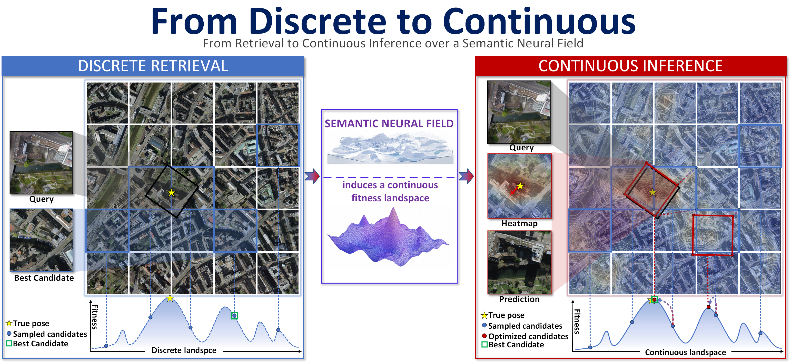
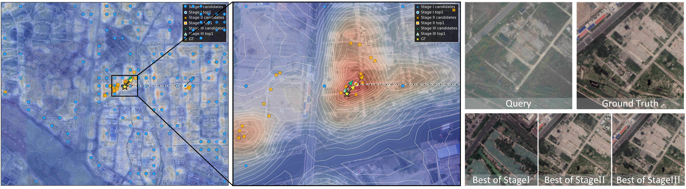
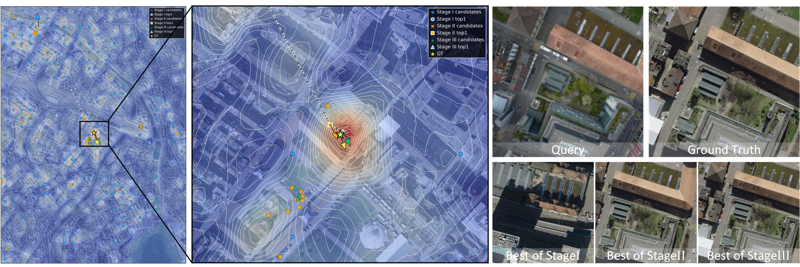

<h1 align="center">ContinuLoc</h1>

<p align="center">
  <strong>Continuous Pose Inference over Neural Fields for UAV Geo-Localization</strong>
</p>

<p align="center">
  <a href="https://neurips.cc/virtual/2026/poster/149317"></a>
  <a href="https://huggingface.co/datasets/wk666/ContinuScenes"></a>
  <a href="https://huggingface.co/wk666/ContinuLoc"></a>
  <a href="#reproduce-inference-with-the-supplied-models"></a>
</p>

<p align="center">
  
</p>

## 🧭 Overview

ContinuLoc estimates a UAV image's continuous 4DoF pose by searching a query–map compatibility landscape. This repository provides training and inference code for the three components in Sections 4.2–4.4 of the paper.

| Paper component | Experiment entry |
|---|---|
| Learning Pose-Sensitive Visual Representations (§4.2) | [Visual encoder](experiments/train_visual_encoder/README.md) |
| Neural Compression of Pose-conditioned Semantic Fields (§4.3) | [Neural field](experiments/train_neural_field/README.md) |
| Hierarchical Search over the Compatibility Landscape (§4.4) | [Pose inference](experiments/eval_pose_inference/README.md) |

To evaluate the supplied pretrained models, start with the reproduction workflow below. Retraining the visual encoder or neural field is not required.

## ⚙️ Environment

The reference environment uses Linux x86-64 (glibc 2.31 or later), Python 3.11, and an NVIDIA GPU with a driver that supports CUDA 12.1. Each stage includes the requirements of the previous stage. To add a later stage, install its requirements in the same environment.

| Stage | Requirements file | Adds |
|---|---|---|
| Train the visual encoder | [train_visual_encoder.txt](requirements/train_visual_encoder.txt) | PyTorch 2.1.0, torchvision 0.16.0, and data and training dependencies |
| Train the neural field | [train_neural_field.txt](requirements/train_neural_field.txt) | Kaolin 0.17.0 and dependencies for Kaolin Wisp |
| Evaluate pose inference | [eval_pose_inference.txt](requirements/eval_pose_inference.txt) | EvoTorch for CMA-ES pose refinement |

Neural field training and pose inference require the CUDA 12.1 Toolkit (`nvcc`), a compatible C++ compiler such as GCC 11, and the `libX11` runtime library used by Wisp's dependencies. Set `CUDA_HOME` to the toolkit directory if it is outside the default location.

To set up paper inference, run these commands from the repository root:

```bash
conda env create -f environment.yml
conda activate continuloc
python -m pip install -r requirements/eval_pose_inference.txt
python -m pip install --no-build-isolation -e .
```

For visual encoder training, substitute `requirements/train_visual_encoder.txt` and proceed to the [training instructions](experiments/train_visual_encoder/README.md). For neural field training, substitute `requirements/train_neural_field.txt`. Both neural field training and pose inference also require [Kaolin Wisp](https://kaolin-wisp.readthedocs.io/en/latest/pages/install.html).

The Wisp patch makes the NeRF configuration importable, supports Python 3.11, and provides the YAML parser used to load the supplied hash grid configurations. The patch is distributed under the [NVIDIA Source Code License](requirements/kaolin-wisp-LICENSE.txt). From the ContinuLoc root, choose a path for the Wisp checkout and run:

```bash
export KAOLIN_WISP_ROOT=/path/to/kaolin-wisp
git clone https://github.com/NVIDIAGameWorks/kaolin-wisp.git "$KAOLIN_WISP_ROOT"
git -C "$KAOLIN_WISP_ROOT" checkout 931707e50f1511fdb4af55eeb4aed4df23b7c2b1
git -C "$KAOLIN_WISP_ROOT" apply "$PWD/requirements/kaolin-wisp.patch"
python -m pip install --no-build-isolation -e "$KAOLIN_WISP_ROOT"
```

Keep `KAOLIN_WISP_ROOT` set when running neural field training or inference. Run the commands below from the ContinuLoc root.

<a name="reproduce-inference-with-the-supplied-models"></a>

## 🔍 Reproduce inference with the supplied models

### 1. Prepare the data and reproduction bundle

Download the data from [ContinuScenes on Hugging Face](https://huggingface.co/datasets/wk666/ContinuScenes). The example below uses scene 03, so you can download just the manifest and that scene. Install `huggingface_hub` for the `hf` command and run `hf auth login` if the repository requires authentication.

```bash
hf download wk666/ContinuScenes --repo-type dataset \
  --include 'dataset_manifest.json' '03/**' \
  --local-dir /path/to/ContinuScenes
```

Keep `dataset_manifest.json` and `03/` under the same ContinuScenes directory. The manifest resolves the UAV images, aligned satellite maps, pose CSV, and metadata within the downloaded layout.

Download the [published reproduction bundle](https://huggingface.co/wk666/ContinuLoc/tree/main/paper_reproduction_bundle) and the two checkpoints for VisLoc 03:

```bash
hf download wk666/ContinuLoc --repo-type model \
  --include 'paper_reproduction_bundle/**' \
    'visloc_interval_train80_mad/shared/visual_encoder_epoch021.pth' \
    'visloc_interval_train80_mad/visloc_03/neural_field_epoch999.pth' \
  --local-dir /path/to/ContinuLoc-models
```

Keep these directories next to each other so `run.yaml` can find the checkpoints:

```text
ContinuLoc-models/
├── paper_reproduction_bundle/
│   ├── run.yaml
│   ├── bundle.yaml
│   ├── configs/
│   ├── assets/
│   ├── splits/
│   └── contracts/
└── visloc_interval_train80_mad/
    ├── shared/visual_encoder_epoch021.pth
    └── visloc_03/neural_field_epoch999.pth
```

The bundle entrypoint fills in paths from `bundle.yaml` and pairs each configuration with its weights, hash grid, evaluation thresholds, frozen split, and data checks.

### 2. Set local paths and choose an experiment

Edit the bundle's `run.yaml`. For example:

```yaml
bundle: bundle.yaml
model_dir: ..
manifest_dir: /path/to/ContinuScenes
output_dir: /path/to/ContinuLoc/gen_fm_exps/paper_reproduction
experiments:
  - visloc_interval_train80_mad
scenes: [visloc_03]
hardware:
  gpu_ids: '0'
  num_worker: 8
  satmaps_on_cpu: true
eval_n_samples: null
```

Set `manifest_dir` to the downloaded ContinuScenes directory containing `dataset_manifest.json`. Relative paths in `run.yaml` resolve against the directory containing that file. Set `model_dir` to the supplied model directory if you store the weights separately.

This example evaluates VisLoc 03 with the frozen 80/20 interval split and MAD scale filtering. The bundle also provides `visloc_interval_train80_mad` for VisLoc 04 and `wingtra_interval_train90_mad` for Zurich and Zuchwil. To evaluate another scene, download its data and matching weights, then set `experiments` and `scenes` accordingly.

### 3. Check the configuration and run inference

```bash
python experiments/eval_pose_inference/run.py \
  --config /path/to/ContinuLoc-models/paper_reproduction_bundle/run.yaml \
  --dry-run
```

The preflight checks model paths, scene metadata, frozen assignments, and evaluation settings, then writes resolved configurations. It does not load model weights or execute the search.

For a small end-to-end check, set `eval_n_samples: 1` and run without `--dry-run`. Restore `eval_n_samples: null` for full evaluation:

```bash
python experiments/eval_pose_inference/run.py \
  --config /path/to/ContinuLoc-models/paper_reproduction_bundle/run.yaml
```

The bundle supplies each model's hash-grid structure, search settings, evaluation thresholds, and frozen query assignments. Preserve these settings when evaluating the supplied models; the default training configurations in this repository are examples for new experiments. In particular, 18-bit and 19-bit hash grids must match their respective checkpoints.

## 🧪 Train your own models

The training workflow follows the paper: learn a pose-sensitive visual encoder, compress its descriptors into a neural field for each scene, then perform hierarchical pose inference.

1. [Train the visual encoder (§4.2)](experiments/train_visual_encoder/README.md).
2. [Train a scene-specific neural field (§4.3)](experiments/train_neural_field/README.md).
3. [Evaluate continuous pose inference (§4.4)](experiments/eval_pose_inference/README.md).

Training uses shared ContinuScenes configurations and selects scenes by name. Each experiment directory includes one disabled batch example to customize. See the [configuration guide](configs/README.md) for data paths, frozen splits, and model compatibility.

## 🗺️ Example inference results

<p align="center">
  
  <br><em>Taizhou scene.</em>
</p>

<p align="center">
  
  <br><em>Zurich scene.</em>
</p>

## 📚 Citation

If you use this code or the pretrained models in your research, please cite the [ContinuLoc paper](https://neurips.cc/virtual/2026/poster/149317).

```bibtex
@inproceedings{zhou2026continuloc,
  title     = {{ContinuLoc}: Continuous Pose Inference over Neural Fields for {UAV} Geo-Localization},
  author    = {Weikun Zhou and Jinliang Lin and Yu Zang and Lin Xie and HaiqingFu
               and Sheng Ao and Shangshu Yu and Zhiming Luo and Cheng Wang},
  booktitle = {Conference on Neural Information Processing Systems (NeurIPS)},
  year      = {2026},
  url       = {https://neurips.cc/virtual/2026/poster/149317}
}
```
